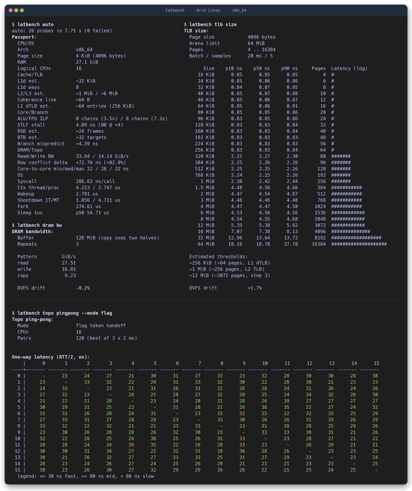

<h3 align="center">latbench</h3>

<p align="center">
    <strong>
    Empirical CPU, cache, TLB, DRAM, and OS latency microbenchmarking suite.
    </strong>
</p>
<p align="center">
    <a href="https://github.com/b1sted/latbench/actions/workflows/tests.yml">
        
    </a>
    <a href="https://github.com/b1sted/latbench/releases/latest">
        
    </a>
    <a href="https://packages.basted.dev/#repositories">
        
    </a>
    <a href="https://github.com/b1sted/homebrew-tap">
        
    </a>
    <a href="#license">
        
    </a>
</p>
<p align="center">
    <a href="#features">Features</a> •
    <a href="#architecture">Architecture</a> •
    <a href="#output">Output</a> •
    <a href="#supported-platforms">Supported Platforms</a> •
    <a href="#installation">Installation</a> •
    <a href="#build-and-run">Build and run</a> •
    <a href="#license">License</a>
</p>
<hr>

Dependency-free latency and microarchitecture benchmarking tool written in strict ISO C99 for Linux, macOS, and Android/Termux.

<br>
<p align="center"><br><em>latbench on Arch Linux (AMD Ryzen 7 7840H)</em></p>
<br>

## Features

- **`sys`**: Timer calibration, `pal_now_ns()` call overhead, and thermal throttling behaviour under sustained load.
- **`mem`**: Cache capacity (L1d, L2, L3) via the Sattolo single-cycle walk, cache-line boundary estimation from stride latency, L1d associativity from set conflicts, and prefetcher behaviour.
- **`tlb`**: L1 dTLB and L2 STLB capacity over a hardware-aligned page grid, plus first-touch page-fault cost versus a warm second pass.
- **`core`**: ILP with independent ALU/FPU chains on the execution ports, MLP through a parallel pointer chase, unaligned read latency, and Store-to-Load Forwarding measured as a clean delta against the aligned `8B @ +0` baseline, including partial and straddling `8B @ +4` overlaps.
- **`branch`**: Predictor history depth, mispredict penalty, Return-Stack Buffer (RSB) capacity up to 96 frames, and Indirect Branch / BTB capacity up to 4096 targets with a multi-callsite pressure sweep.
- **`dram`**: Single- and multi-threaded read, write, and copy bandwidth (`--threads`), DRAM row-buffer locality, and pure DRAM latency comparing a 2 MiB THP arena with a 4 KiB page-walk pass.
- **`topo`**: L1 atomics (`fetch_add`, `fence_seq`), the false-sharing (coherence line) boundary, and a core-to-core latency matrix (RTT/2) through CAS and flag ping-pong, using `pal_cpu_list()` and best-of-five batches per pair.
- **`os`**: vDSO versus `sys_write` overhead, thread and process context switches (pipes), scheduler wakeup (`mutex+cond`), TLB shootdown (`mprotect`), `fork()`, `SIGUSR1` delivery, `nanosleep` overshoot, and, on Linux only, swap-in latency via `/proc/swaps` and `MADV_PAGEOUT` (`os swap`, not part of `auto`).
- **`auto`**: Runs the full cycle of 27 key probes and prints a single `Passport:` card, or a machine-readable `--csv` table. Transparent huge pages are enabled automatically when the kernel supports them and neither `--thp` nor `--no-thp` was given.
- **Zero bloat**: Clean ISO C99, no external dependencies, and an isolated platform abstraction layer (PAL).

## Architecture

The code is split into a portable engine, benchmark modules, and a thin platform abstraction layer:

```text
include/            Public headers shared across core, bench, and PAL
  pal/              Platform abstraction and compiler primitive interfaces
src/core/           Portable engine: CLI, stats, step detector, TTY plots, main
src/bench/          Benchmark suites (sys, mem, tlb, core, branch, dram, topo, os)
src/platform/       Platform implementations
  pal_posix.c       POSIX.1-2008 fallbacks (threads, pipes, signals, mappings)
  pal_linux.c       Linux/Android specifics (affinity, THP, /proc, MADV_PAGEOUT)
  pal_macos.c       macOS specifics (mach_absolute_time, QoS, sysctl)
  pal_internal.h    Private pal_mem and pal_thread layouts shared by the above
tests/              Unit, integration, and optimizer self-tests
```

`src/core/` and `src/bench/` never include OS headers directly: every platform
primitive (timers, memory, threads, atomics, affinity) is reached through
`include/pal/`. See [STYLEGUIDE.md](./STYLEGUIDE.md) for the full layering,
naming, and safety rules.

## Output

A typical `latbench auto` run on an AMD Ryzen 7 7840H under Arch Linux:

```text
Passport:
  CPU/OS
  Arch                 x86_64
  Page size            4 KiB (4096 bytes)
  RAM                  27.1 GiB
  Logical CPUs         16
  Cache/TLB
  L1d est.             ~32 KiB (0.85 ns)
  L1d ways             8
  L2/L3 est.           ~1 MiB (2.97 ns) / ~5 MiB (51.90 ns)
  Coherence line       ~64 B
  L1 dTLB est.         ~256 entries (1 MiB)
  Core/Branch
  ALU/FPU ILP          8 chains (3.5x) / 8 chains (7.2x)
  STLF stall           2.48 ns (8B @ +4)
  RSB est.             ~24 frames
  BTB est.             ~32 targets
  Branch mispredict    ~4.60 ns
  DRAM/Topo
  Read/Write BW        18.39 / 15.88 GiB/s
  RAM lat              154.93 ns
  Row conflict delta   +69.72 ns (+78.2%)
  Core-to-core min/med/max 21 / 26 / 32 ns
  OS
  Syscall              285.92 ns/call
  Ctx thread/proc      3.554 / 4.243 us
  Wakeup               3.534 us
  Shootdown 1T/MT      1.892 / 4.027 us
  Fork                 363.12 us
  Sleep 1us            p50 54.19 us
```

| Metric | Description |
| --- | --- |
| `Arch` | Machine architecture reported by the platform layer. |
| `Page size` | Base virtual-memory page size in bytes, used by the TLB probes. |
| `RAM` | Total physical memory available to the process. |
| `Logical CPUs` | Logical processors visible to the OS. |
| `L1d est.` | First-level data cache capacity estimated with a Sattolo cycle walk, with the measured plateau latency (`l1d_ns`). |
| `L1d ways` | L1d associativity inferred from set-conflict strides. |
| `L2/L3 est.` | Upper-level cache capacities from the same latency-plateau walk, with their plateau latencies (`l2_ns`, `l3_ns`). |
| `Coherence line` | Cache-line size derived from false-sharing and stride probes. |
| `L1 dTLB est.` | First-level dTLB entry count and the address range it covers. |
| `ALU/FPU ILP` | Independent chains that saturate the ALU and FPU ports, with speedup versus one chain. |
| `STLF stall` | Worst partial-overlap store-forwarding delta (`4B @ +1` or `8B @ +4`) relative to the aligned `8B @ +0` baseline. |
| `RSB est.` | Return-Stack Buffer depth in call frames (swept up to 96 frames). |
| `BTB est.` | Indirect-branch target capacity of the branch-target buffer (swept up to 4096 targets). |
| `Branch mispredict` | Penalty of a deliberately mispredicted branch. |
| `Read/Write BW` | Single-thread DRAM read and write bandwidth; `dram bw` also prints multi-threaded figures. |
| `RAM lat` | Pure DRAM latency from the THP pass of `dram lat` (`ram_ns`), or the 4 KiB pass when THP is unavailable. |
| `Row conflict delta` | Extra latency caused by opening a different DRAM row. |
| `Core-to-core` | Minimum, median, and maximum round-trip/2 latency between cores. |
| `Syscall` | Cost of a minimal `sys_write` call, with vDSO comparison available in `os syscall`. |
| `Ctx thread/proc` | Thread and process context-switch latency over pipes. |
| `Wakeup` | Scheduler wakeup latency through `mutex+cond`. |
| `Shootdown 1T/MT` | TLB shootdown cost for single-threaded and multi-threaded `mprotect`. |
| `Fork` | End-to-end `fork()` latency. |
| `Sleep 1us` | Median `nanosleep` overshoot for a 1 microsecond request. |

Run `latbench <module> <subtest>` for the full per-probe output, or add
`--csv` to `auto` to emit a `module,subtest,metric,value,unit` table on
`stdout`. The passport rows include `l1d_ns`, `l2_ns`, `l3_ns`, and `ram_ns`
alongside the capacity, bandwidth, branch, topology, and OS metrics.

## Supported Platforms

`latbench` natively supports the following architectures and operating systems
out of the box:

- **macOS**:
  - Apple Silicon (ARM64) on macOS 11.0+.
  - Intel Modern (x86_64) on macOS 10.9+.
  - Intel Legacy (x86_64) on Mac OS X 10.7+.
- **Linux**: x86_64, ARM64, ARMv7, and RISC-V 64. Standalone archives are
  statically linked through `STATIC=1` and do not depend on the host glibc
  version.
- **Android**: Termux on `aarch64`, `armv7`, and `x86_64`.
- **Embedded**: tested on the Luckfox Pico Plus (ARMv7, uClibc, 33 MiB RAM).

## Installation

The easiest way to install and keep `latbench` up to date is via the
[basted packages repositories](https://packages.basted.dev/#repositories) or
Homebrew. Standalone packages and archives are also attached to every
[GitHub Release](https://github.com/b1sted/latbench/releases).

### Homebrew (macOS & Linux)

```bash
brew install b1sted/tap/latbench
```

The tap tracks the latest stable release and builds it from source for the
current platform.

### Linux repositories (`apt`, `dnf`, `pacman`)

All Linux repositories carry native builds for `amd64`, `arm64`, `armv7`, and
`riscv64`, signed with the repository key (`packages.basted.dev/gpg.key`).

#### Debian / Ubuntu (`apt`)

Supports Debian 12+, Ubuntu 22.04+, and compatible derivatives:

```bash
curl -fsSL https://packages.basted.dev/gpg.key \
  | sudo gpg --yes --dearmor -o /usr/share/keyrings/basted.gpg

echo "deb [signed-by=/usr/share/keyrings/basted.gpg] \
https://packages.basted.dev/apt stable main" \
  | sudo tee /etc/apt/sources.list.d/basted.list

sudo apt update
sudo apt install latbench
```

#### Fedora / RHEL (`dnf`)

Supports Fedora, RHEL 9+, and compatible rebuilds:

```bash
sudo tee /etc/yum.repos.d/basted.repo >/dev/null <<'EOF'
[basted]
name=basted packages
baseurl=https://packages.basted.dev/rpm
enabled=1
gpgcheck=1
repo_gpgcheck=1
gpgkey=https://packages.basted.dev/gpg.key
EOF

sudo dnf install latbench
```

#### Arch Linux (`pacman`)

```bash
curl -fsSL https://packages.basted.dev/gpg.key \
  | sudo pacman-key --add -
sudo pacman-key --lsign-key 3DFD8F2C2444ED194636CED66F19EE24A4124218

printf '\n[basted]\nSigLevel = Required DatabaseOptional\n%s\n' \
  'Server = https://packages.basted.dev/arch/$arch' \
  | sudo tee -a /etc/pacman.conf >/dev/null

sudo pacman -Syu
sudo pacman -S latbench
```

<details>
<summary>Manual installation from GitHub Release packages (.deb / .rpm / .pkg.tar.zst)</summary>

Download the package for your distribution and architecture from the
[GitHub Releases](https://github.com/b1sted/latbench/releases) page and install
it locally:

```bash
# Debian / Ubuntu
sudo apt install ./latbench_0.2.0_*.deb

# Fedora / RHEL / openSUSE
sudo dnf install ./latbench-0.2.0.*.rpm

# Arch Linux
sudo pacman -U ./latbench-0.2.0-*.pkg.tar.zst
```

</details>

### Android (Termux)

Native Termux builds are available for `aarch64`, `arm`, and `x86_64` via the
Termux repository:

```bash
pkg install gnupg
mkdir -p "$PREFIX/etc/apt/trusted.gpg.d" "$PREFIX/etc/apt/sources.list.d"
curl -fsSL https://packages.basted.dev/gpg.key \
  | gpg --yes --dearmor -o "$PREFIX/etc/apt/trusted.gpg.d/basted.gpg"
echo "deb https://packages.basted.dev/termux stable main" \
  > "$PREFIX/etc/apt/sources.list.d/basted.list"

pkg update
pkg install latbench
```

<details>
<summary>Manual installation from GitHub Release (.deb)</summary>

Termux release files use a `latbench-termux_` filename prefix so they are not
confused with the native Linux packages, while the installed package name is
`latbench`:

```bash
pkg install ./latbench-termux_0.2.0_*.deb
```

</details>

### Prebuilt binaries (`.tar.gz`)

Standalone archives are published for Linux (`amd64`, `arm64`, `armv7`,
`riscv64`, and Luckfox ARM), Android/Termux, and macOS (`arm64`, Intel modern,
and Intel legacy). The Linux archives contain static binaries built with
`STATIC=1`, so they run on any distribution regardless of the glibc version.
Download the archive for your platform, unpack it, and move `latbench` onto
your `PATH`:

```bash
tar -xzf latbench-linux-amd64.tar.gz
sudo install -m 0755 latbench /usr/local/bin/latbench
```

> [!NOTE]
> macOS marks binaries downloaded through a browser as quarantined. Remove the
> attribute before the first run:
>
> ```bash
> xattr -d com.apple.quarantine ./latbench
> ```

### Verification

Release assets use a dedicated release signing subkey
([github.com/b1sted.gpg](https://github.com/b1sted.gpg)), while package
repositories use the package signing subkey
([packages.basted.dev/gpg.key](https://packages.basted.dev/gpg.key)). Verify
downloaded GitHub Release archives with any of the following methods:

```bash
# SHA256 checksums
sha256sum -c SHA256SUMS.txt --ignore-missing

# GPG signature
curl -fsSL https://github.com/b1sted.gpg | gpg --import && \
  gpg --verify SHA256SUMS.txt.asc SHA256SUMS.txt

# GitHub build attestation
gh attestation verify latbench-linux-amd64.tar.gz --repo b1sted/latbench
```

## Build and run

### Compilation from source

Requires a C99 compiler with a POSIX.1-2008 environment and GNU `make`. On
macOS, install the Xcode Command Line Tools. On Android/Termux, only `clang`
and `make` are needed.

```bash
make                # -O2 release binary in build/bin/latbench
make dev            # strict -Werror debug build
make test           # unit tests + -O2 selftest
make leaks          # AddressSanitizer/UBSan run with bounded test buffers
make lint           # style, format, clang-tidy, and cppcheck (when installed)
make STATIC=1       # self-contained static binary (Linux only)
```

Override the version at build time with `make VERSION=<version>`; release
builds derive it from the Git tag.

### Usage

```bash
./build/bin/latbench auto
./build/bin/latbench mem size
./build/bin/latbench --help
```

The full option list:

| Option | Description |
| --- | --- |
| `--cpu <id>` | Pin the worker to logical CPU `<id>`. |
| `--qos <perf\|bg>` | Request `perf` or `bg` QoS (macOS). |
| `--max-mem <MiB>` | Cap the arena size (default: 25% of RAM; `dram bw` caps at 512 MiB and `dram lat` at 256 MiB). |
| `--batch-ms <ms>` | Measurement batch duration (default: 20). |
| `--cool-ms <ms>` | Cool-down between batches (default: 0). |
| `--no-thp` / `--thp` | Avoid or allow transparent huge pages. The standalone default is `--no-thp`; `auto` enables THP when the kernel reports `always` or `madvise` and neither flag was given explicitly. |
| `--threads <n>` | Worker threads for `dram bw` (default: auto, one per available CPU; capped at 64 and by the minimum slice size). Only valid for `dram bw`. |
| `--no-timing` | Skip the hardware ratio thresholds in `selftest` (for emulators and very noisy hosts). Only valid for `selftest`. |
| `--write` | Modify words during the memory size walk (dirty write-back). |
| `--long` | Extend the `sys throttle` duration to 10 seconds. |
| `--mode <mode>` | Handoff/switch mode: `cas`/`flag` for `topo pingpong`, `thread`/`proc` for `os ctx`. |
| `--csv` | Emit CSV to `stdout`; diagnostics go to `stderr`. |
| `--no-color` | Disable color output. |
| `-h`, `--help` | Display help and exit. |
| `-V`, `--version` | Output version information and exit. |

`-V` prints the build version and machine architecture:

```bash
./build/bin/latbench -V
# latbench v0.2.0 (x86_64)
```

`make test` runs the unit tests and then executes `./build/bin/latbench selftest`
on the `-O2` binary, verifying that optimizations did not eliminate benchmark
loops or break Sattolo single-cycle integrity. `make leaks` reruns the bounded
tests under AddressSanitizer and UndefinedBehaviorSanitizer.

The `Tests and Linters` GitHub Actions workflow runs `make test`, the QEMU
cross-architecture self-tests, `make leaks`, and `make lint`.

The manual `RISC-V 64 Live Calibration` workflow (`riscv64.yml`) runs the same
strict build and tests on RISE RISC-V Runners (`ubuntu-24.04-riscv`). It can
optionally execute `make leaks`, a live `auto` calibration (human-readable and
CSV), and standalone `mem line`, `dram lat`, `dram bw`, `topo pingpong`, and
`os swap` probes, then uploads the host environment, passport CSV, and text
logs as build artifacts.

## License

Distributed under the **GNU General Public License v3.0** (GPL-3.0).

You are free to use, study, modify, and redistribute this software under the
terms of the GPL. Any distributed derivative must remain under the same
license and include the source code.

Full text of the license: [LICENSE](./LICENSE).
